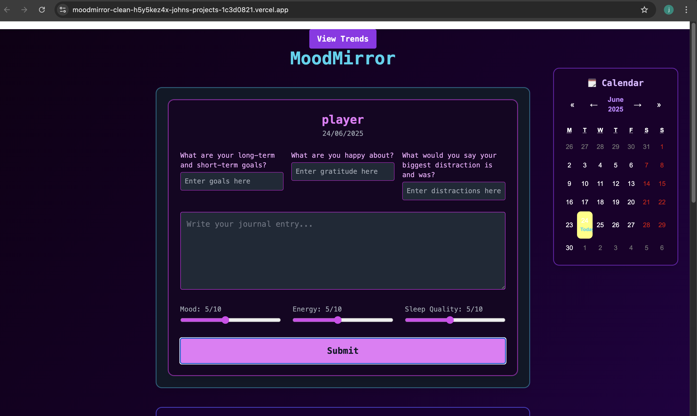
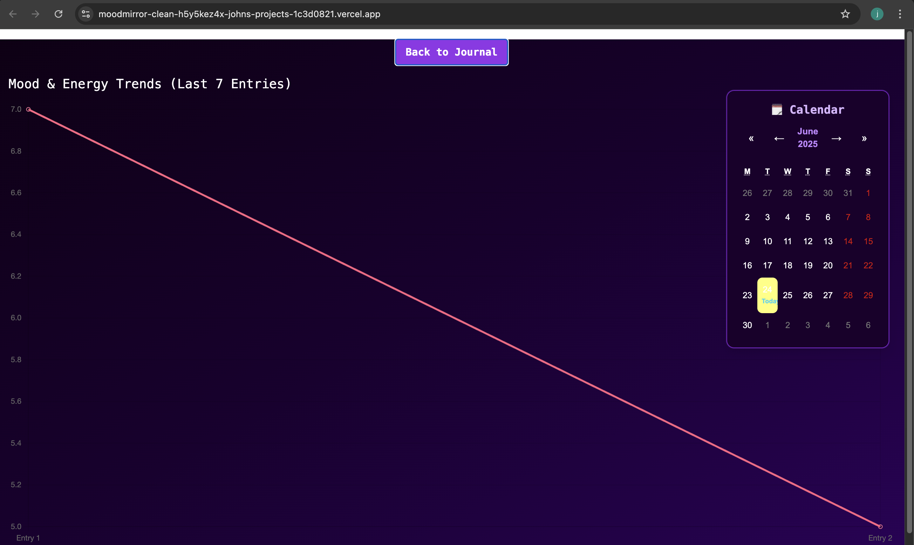
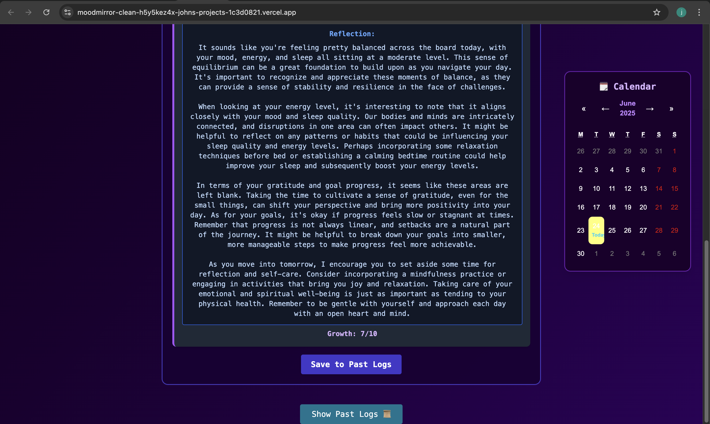

# MoodMirror

**MoodMirror** is a personal journaling app I built with React and TailwindCSS to explore the intersection of mental wellness and AI. It allows users to log daily reflections while receiving meaningful AI-generated feedback based on their mood, energy, habits, and personal growth. The app is fully deployed on Vercel and designed with modularity, responsiveness, and clarity in mind.

### Live Demo  
👉 [View MoodMirror Live on Vercel](https://moodmirror-clean-git-main-johns-projects-1c3d0821.vercel.app)


## 📸 App Screenshots

### Home Screen  


### Trends View  


### AI Reflection  



---

## Why I Built It

I created MoodMirror as a capstone-style solo project to strengthen my frontend development skills while also applying real AI use cases in a meaningful way. It was important for me to build something that wasn’t just functional but also personally impactful — something I’d want to use myself to track growth and mindset.

This project helped me:
- Practice React fundamentals through real UI and state logic
- Integrate OpenAI’s API and design effective prompts
- Use Tailwind for a clean, responsive UI
- Learn how to debug, deploy, and polish a full-stack project

---

## Key Features

- **Journaling Interface** – Custom form inputs for mood, energy, gratitude, goals, distractions, and freeform reflection
- **AI Reflection** – GPT generates tailored feedback for each journal entry based on prompt engineering
- **Trends Dashboard** – Uses Chart.js to display mood/energy patterns over the last 7 entries
- **Local Storage** – Journals persist even on refresh, no backend required
- **Responsive Design** – Fully styled with TailwindCSS and optimized for desktop & mobile

---

## Tech Stack

- **Frontend**: React.js, TailwindCSS, Chart.js
- **AI Integration**: OpenAI API
- **State Management**: React hooks
- **Data Persistence**: localStorage
- **Deployment**: Vercel

---

## Project Structure

```
client/
├── api/
│   └── reflect.js        # Vercel serverless function: calls OpenAI, keeps the key server-side
├── public/
├── src/
│   ├── components/       # JournalFormUI, EntryCard, Trends, ShadowCalendar, ...
│   ├── storage.js        # safe localStorage helpers
│   ├── App.js
│   └── index.js
├── .env.example
└── tailwind.config.js
```

---

## How to Run Locally

The OpenAI key is only ever used by the serverless function in `client/api/`, so run the app with the Vercel CLI (plain `npm start` does not serve `/api`).

1. Clone the repo
   ```bash
   git clone https://github.com/JfundsTMT/moodmirror-clean.git
   cd moodmirror-clean/client
   npm install
   ```

2. Add your key (see `.env.example`)
   ```
   MOODMIRROR_OPENAI_API_KEY=your-api-key
   ```

3. Start the app
   ```bash
   npx vercel dev
   ```

## Deploying

Set `MOODMIRROR_OPENAI_API_KEY` in the Vercel project's Environment Variables (Production and Preview), with the project root set to `client`. Never prefix it with `REACT_APP_`: Create React App bundles those variables into public JavaScript.

---

## Future Improvements

- Add user authentication (multi-user journaling)
- Integrate memory/contextual GPT feedback
- Export journal entries as PDF or CSV
- Weekly mood summaries and tags
- Cloud storage integration for syncing across devices

---

## Personal Reflection
Building this project deepened my appreciation for how AI can support personal growth and reflection. It challenged me to bring together UI polish, functional state logic, and prompt engineering in a cohesive way. This is a project I would personally use — and that’s what made it rewarding. I’m proud of how far it’s come and eager to keep refining it.
